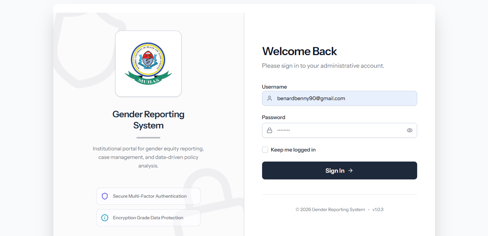

# Gender Reporting System

### _Empowering Justice through Secure and Anonymous Incident Reporting_


> A secure, anonymous and survivor-centred platform for reporting gender-based violence and
> harassment — built for the people who need it most, and for the institutions that respond to them.

---

## 📌 Project Identity

The **Gender Reporting System** is a professional-grade platform built to solve the critical problem of
under-reporting in gender-based violence and harassment. By providing a secure, anonymous, and guided
reporting environment, it lowers the barrier for victims and informants to seek help while ensuring that
law enforcement and administrators have structured data to investigate incidents effectively.

| | |
| :-- | :-- |
| **Problem** | Fear, stigma and complex procedures keep incidents unreported. |
| **Solution** | A guided, anonymous, trauma-informed reporting flow with a private tracking ID. |
| **Outcome** | More incidents documented, faster case assignment, and auditable institutional oversight. |

---

## 📸 Screenshots

### Landing Page

A calm, accessible entry point that explains the reporting process and puts the **Report Incident**
and **Quick Exit** actions within immediate reach.


### Secure Login

Role-aware authentication for administrators and officers, protected by Laravel Fortify with
optional two-factor authentication.



### Guided Reporting Flow

#### Step 1 — Informant Details

The 6-step incident stepper begins here. Choosing **Report Anonymously** automatically skips all
identifying fields while keeping the report legally valid.


#### Step 2 — Victim Details

Each step is validated in real time, so a report can never be submitted with incomplete or
inconsistent information.


### Admin Dashboard

#### Operational Overview

Live case metrics, status distribution and recent activity give administrators a single source
of truth across every report.


#### Case & Staff Management

Assign cases to officers, review audit logs, manage staff accounts and export statistical
reports — all from one console.


---

## ✨ Key Features

1. **Anonymous Reporting Flow** — Victims can choose to remain fully anonymous, automatically skipping
   informant identification steps while maintaining legal validity.
2. **6-Step Incident Stepper** — A guided, structured process for documenting Informants, Victims,
   Accused Details, and Incident Specifics with real-time validation.
3. **UUID-Based Secure Tracking** — Every report generates a unique, non-sequential tracking ID (UUID)
   allowing users to monitor progress without a permanent account.
4. **Quick Exit Safety Mechanism** — A "panic button" that instantly redirects the user to a neutral
   site (e.g. weather reports) and wipes local form state for immediate safety.
5. **Multi-Role Management** — Dedicated dashboards for **Admins** (system oversight) and **Officers**
   (case investigation and assignment).
6. **Case Workflow Engine** — Intake → Investigation → Escalation → Resolution, with a complete
   activity trail for every case.
7. **Audit & Reporting** — Activity logging via `spatie/laravel-activitylog` and downloadable PDF
   reports via `spatie/laravel-pdf` and `dompdf`.
8. **Theming & Accessibility** — First-class light, dark and system modes driven by Tailwind CSS
   variables for consistent contrast.

---

## 🛠 Tech Stack Overview

| Category               | Technology                                                                     |
| :--------------------- | :----------------------------------------------------------------------------- |
| **Framework**          | [Laravel 13](https://laravel.com/) (PHP 8.3+)                                  |
| **Frontend**           | [React 19](https://react.dev/) with [Inertia.js 3](https://inertiajs.com/)     |
| **Language**           | [TypeScript](https://www.typescriptlang.org/)                                  |
| **State Management**   | [Zustand](https://github.com/pmndrs/zustand)                                   |
| **UI Components**      | [Shadcn UI](https://ui.shadcn.com/) & [Radix UI](https://www.radix-ui.com/)    |
| **Styling**            | [Tailwind CSS v4](https://tailwindcss.com/)                                    |
| **Icons**              | [Lucide React](https://lucide.dev/)                                            |
| **Authentication**     | [Laravel Fortify](https://laravel.com/docs/13.x/fortify)                       |
| **Validation**         | [Zod](https://zod.dev/) + Laravel Form Requests                                |
| **Build Tool**         | [Vite 8](https://vite.dev/)                                                    |
| **Document Generation**| [spatie/laravel-pdf](https://spatie.be/docs/laravel-pdf) & Dompdf              |
| **Audit Trail**        | [spatie/laravel-activitylog](https://spatie.be/docs/laravel-activitylog)       |

---

## 🚀 Getting Started

### Prerequisites

- PHP **8.3+** with the usual Laravel extensions
- Composer 2
- Node.js **20+** and npm
- SQLite, MySQL or PostgreSQL

### Installation

1. **Clone the repository:**

    ```bash
    git clone <repo-url>
    cd laravel-react-gender-appV3
    ```

2. **Install PHP dependencies:**

    ```bash
    composer install
    ```

3. **Install Node dependencies:**

    ```bash
    npm install
    ```

4. **Set up the environment:**

    ```bash
    cp .env.example .env
    php artisan key:generate
    ```

5. **Migrate and seed the database:**

    ```bash
    php artisan migrate --seed
    ```

### Execution

- **Development Mode:**

    ```bash
    npm run dev
    # In a separate terminal
    php artisan serve
    ```

    Or run everything at once (server, queue, logs and Vite):

    ```bash
    composer dev
    ```

- **Production Build:**

    ```bash
    npm run build
    ```

### Testing & Code Quality

```bash
php artisan test        # PHP test suite
npm run types:check     # TypeScript type checking
npm run lint:check      # ESLint
npm run format:check    # Prettier
```

Or run the full pipeline in one go:

```bash
composer ci:check
```

---

## 🏗 Architecture Deep-Dive

The project follows a modern **Modular Monolith** architecture using Inertia.js to bridge the gap
between Laravel and React.

- **`resources/js/hooks/store/`** — Contains `useStepperFormStore.ts`, a sophisticated Zustand store
  that manages the complex state of the multi-step reporting form, including persistence and
  conditional step skipping.
- **`resources/js/components/`** — Divided into `ui/` (Shadcn primitives) and specialized folders like
  `reporter/` for business-specific logic.
- **`resources/js/pages/`** — Inertia page components, grouped by audience: `reporter/`, `dashboard/admin/`,
  `dashboard/officer/` and `dashboard/general/`.
- **`resources/js/hooks/`** — Utility hooks such as `useAppearance.tsx` for theme management and
  `useTwoFactorAuth.ts` for security.
- **`app/Models/`** — Utilizes UUIDs (`HasUuids`) across all incident-related models to prevent ID
  enumeration and enhance privacy.
- **`app/Http/Controllers/`** — Role-scoped controllers (`AdminController`, `OfficerController`,
  `ReporterController`, `CaseWorkflowController`) keep authorization boundaries explicit.

---

## 🔑 Environment Variables

Required keys in your `.env` file:

| Key              | Description                      | Default            |
| :--------------- | :------------------------------- | :----------------- |
| `DB_CONNECTION`  | Database driver                  | `sqlite`           |
| `SESSION_DRIVER` | Storage for session data         | `database`         |
| `APP_URL`        | Base URL of the application      | `http://localhost` |
| `VITE_APP_NAME`  | App name visible in the frontend | `${APP_NAME}`      |

> **Privacy note:** session and cache drivers should not be set to `array` in production, and
> `APP_DEBUG` must be `false` before any real deployment.

---

## 🔍 Component Highlights

### Case Tracking Flow

The system utilizes the `CaseTrackingId` component to deliver the tracking UUID post-submission.

- **Security:** The ID is displayed only once and cannot be recovered if lost.
- **Privacy:** Masking logic ensures the ID is only visible when the user explicitly clicks the
  "Show ID" button.

### Theme Switching Logic

The `ChangeTheme` component provides a seamless transition between **Light**, **Dark**, and **System**
modes.

- **Persistence:** Choices are stored locally and synced with the server via the `HandleAppearance`
  middleware.
- **Aesthetics:** Uses Tailwind 4 variable mapping to ensure consistent contrast and accessibility
  across all themes.

### Quick Exit Safety Mechanism

A persistent panic action that immediately navigates away to a neutral destination and clears
locally persisted form state — no confirmation dialogs, no recovery prompts.

---

## 🔐 Security & Privacy Principles

- **Data minimisation** — anonymous reports never store identifying information.
- **Non-enumerable identifiers** — UUIDs everywhere, no sequential auto-increment leakage.
- **Least privilege** — admin, officer and reporter surfaces are separated by middleware and policies.
- **Full auditability** — every meaningful action is recorded in the activity log.
- **Safe defaults** — two-factor authentication supported, email verification available, and
  session-backed persistence.

---

## 🤝 Contributing

1. Create a feature branch: `git checkout -b feature/your-feature`
2. Follow the existing code style (`composer lint`, `npm run format`).
3. Make sure `composer ci:check` passes.
4. Open a pull request describing the change and its motivation.

---

## 📄 License

Released under the [MIT License](https://opensource.org/licenses/MIT).

---

_Created and maintained with ❤️ for victim safety._
